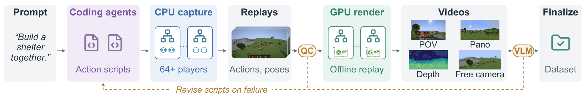

# PAWA Pipeline

Data-generation pipeline for **PAWA: Panoramic Action-conditioned World Modeling for Multiple
Agents**. It turns scripted multiplayer Minecraft sessions into synchronized per-player
point-of-view (POV) videos, world-stabilized equirectangular panoramas, and frame-aligned actions
and camera poses.

- **Project page:** <https://pawa.siki.moe>
- **Dataset:** <https://huggingface.co/datasets/YOUSIKI/pawa-dataset>
- **Paper:** <https://arxiv.org/abs/2610.20240>



Existing multiplayer Minecraft data is recorded by screen capture from live game clients: one
graphics client per player, and only the perspective view displayed during play. This pipeline
removes rendering from gameplay:

- **CPU capture.** A headless player runtime built on
  [Azalea](https://github.com/azalea-rs/azalea) executes Rust action scripts against a Fabric
  server and records per-tick actions, positions, camera orientations and player state, while
  ReplayMod recordings are saved for later rendering. No graphics client is
  involved, so a session scales past 64 simultaneous players (64- and 128-player sessions have been
  recorded) and independent episodes run in parallel across CPU hosts.
- **GPU render.** Saved replays are rendered offline by ReplayMod on separate GPU hosts
  (VirtualGL/EGL), one job per view: the player's rectilinear POV and an equirectangular panorama
  from the same camera origin, optionally relative depth, and free "observer" cameras along custom
  trajectories. A recorded session can be re-rendered under new observation configurations without
  replaying the gameplay.
- **Finalize.** Every stream is mapped to the server's world-age clock, cropped to the interval
  covered by the actions of all retained players, and shipped as pre-joined per-frame rows. The
  layout is a drop-in superset of the Solaris multiplayer dataset format.
- **Scenario authoring with agents.** Scenarios are natural-language descriptions of player
  behavior and expected outcome. Coding agents compose reusable interaction primitives into Rust
  scripts; a behavioral QC gate (inactivity, ineffective movement, abrupt control changes) runs on
  the capture before rendering, and a vision-language model reviews rendered samples against the
  described outcome. Both return feedback for revision. The catalog ships 191 collection scenarios, 3 evaluation-only scenarios
  and a many-player showcase scenario.

Default output: POV 640×360 and panorama 1024×512 at 20 Hz.

## Layout

| Path | Role |
|---|---|
| `crates/schema` | every JSON contract (manifest, capture, dataset rows), the scenario catalog, clock-domain types |
| `crates/players` | the Azalea-based player runtime and all scenario scripts (action scripts) |
| `crates/capture` | Fabric server lifecycle, RCON, scenery, player-shard supervision |
| `crates/render` | Xvfb + HeadlessMC + ReplayMod driver session, media description |
| `crates/align` | clock join, per-frame row assembly, behavioral QC, observer camera planning |
| `crates/hud` | action-HUD overlay video for checking action/frame alignment by eye |
| `crates/pawa` | the `pawa` CLI: manifest → HyperQueue plan → units → run report |
| `assets/renderer/replaymod-driver-mod` | Java Fabric mod that drives ReplayMod renders |
| `docker/` | the all-in-one runtime image (Minecraft, Fabric, HeadlessMC, VirtualGL, HyperQueue) |
| `ops/` | HyperQueue launchers, example manifests, manifest generator, dataset audit tools |
| `viewer/` | static web viewer that streams episodes from a Hugging Face dataset repo |

## Quick start

Requirements: Linux, Docker with BuildKit, network access during the image build (it downloads
Minecraft, Fabric, ReplayMod and HyperQueue; the image is about 3 GB and builds in a few minutes
with a warm cache), and, for GPU rendering, an NVIDIA GPU with the NVIDIA container toolkit. A
capture runs a Minecraft server with an 8 GB heap by default, so plan for 16 GB of RAM or more.
[`just`](https://github.com/casey/just) is optional; each recipe in the `Justfile` is a plain
command.

```bash
just image
```

```bash
just smoke
```

`just smoke` runs the full path on one host: CPU capture of two 2-player episodes from
`ops/smoke.json`, GPU rendering (VirtualGL/EGL), and finalize. The episodes land in
`/tmp/pawa-smoke/dataset/` (written by the container as root), with per-unit status under
`status/` and the run summary under `runs/`. On a
machine without a GPU, `just smoke-cpu` renders the same episodes with software GL (Mesa
llvmpipe), which is correct but much slower. At scale, capture and rendering run
on separate CPU and GPU pools; see [`docs/distributed.md`](docs/distributed.md).

Build and test the workspace on the host (the nightly toolchain is pinned in `rust-toolchain.toml`;
building also needs a C compiler and CMake, and the tests need `ffmpeg`):

```bash
just test
```

## Running collections

A run is described by a JSON manifest: episodes (scenario, seed, player count, duration) plus
render settings. Generate one from the scenario catalog:

```bash
python3 ops/gen_manifest.py --list
```

```bash
python3 ops/gen_manifest.py --run-id demo --scenarios landmark_tour follow_leader --players 2 4 --out demo.json
```

Without `--scenarios`, every collection scenario is emitted. `ops/work.example.json` shows a
manifest with every render setting spelled out. The `pawa` CLI validates, plans and executes it;
it is the image's entrypoint (`docker run --rm pawa-pipeline:latest <command>`), or run it from
the workspace with `cargo run --release -p pawa -- <command>`:

```sh
pawa manifest --manifest demo.json            # validate + plan summary
pawa plan --manifest ... --out ... [--stage capture|render|all] [--resume]
pawa unit capture|render-pov|render-observer|finalize|hud ...   # schedulable units
pawa run-report --manifest ... --out ...
pawa qc-actions --capture-dir ...             # behavioral QC gate (exit 0 pass / 3 fail)
pawa hud --video ... --frames ... --out ...   # burn the action HUD into a POV video
pawa schema-export --out ...                  # JSON Schemas of every contract
pawa doctor                                   # host preflight
```

Units are scheduled with [HyperQueue](https://github.com/It4innovations/hyperqueue).
`ops/hq_head.sh` runs the server, the submit/retry loop and a local worker; `ops/hq_worker.sh`
adds workers on other hosts that share the output directory. Capture and rendering can run as
separate stages on different machines over the same output tree; see
[`docs/distributed.md`](docs/distributed.md). Example manifests: `ops/smoke.json`,
`ops/observer-smoke.json` (free cameras), `ops/many-player-acceptance.json` (4 to 16 players),
`ops/regional-showcase-n{64,128}.json` (64 and 128 players; see
[`docs/many-player-sessions.md`](docs/many-player-sessions.md)).

## Documentation

- [`docs/dataset-spec.md`](docs/dataset-spec.md): episode layout and every shipped field
- [`docs/time-alignment.md`](docs/time-alignment.md): clocks and how actions align to frames
- [`docs/scenario-authoring.md`](docs/scenario-authoring.md): writing and validating scenarios
- [`docs/evaluation-scenarios.md`](docs/evaluation-scenarios.md): evaluation-only scenario families
- [`docs/distributed.md`](docs/distributed.md): multi-host capture and render deployment
- [`docs/many-player-sessions.md`](docs/many-player-sessions.md): 64- and 128-player sessions and free cameras
- [`viewer/README.md`](viewer/README.md): browsing a released dataset in the browser

## Citation

```bibtex
@article{yang2026pawa,
  title   = {{PAWA}: Panoramic Action-conditioned World Modeling for Multiple Agents},
  author  = {Yang, Siqi and Wang, Yimu and Cai, Ziqi and Zhu, Chengxuan and Weng, Shuchen and
             Wu, Erwin and Yu, Zhaofei and Zhang, Kaipeng and Shi, Boxin},
  journal = {arXiv preprint arXiv:2610.20240},
  year    = {2026},
  url     = {https://arxiv.org/abs/2610.20240}
}
```

## License

Code is released under Apache-2.0 (see [`LICENSE`](LICENSE) and [`NOTICE`](NOTICE)). Third-party
components and their licenses are listed in [`THIRD_PARTY_LICENSES.md`](THIRD_PARTY_LICENSES.md).

Minecraft is a trademark of Mojang Synergies AB; this project is not affiliated with Mojang or
Microsoft. The Docker build downloads Minecraft, Fabric, ReplayMod and other third-party
components, each under its own license, and the capture stage writes `eula=true` for the dedicated
server it starts. By building or running the pipeline you accept the
[Minecraft EULA](https://www.minecraft.net/eula).
